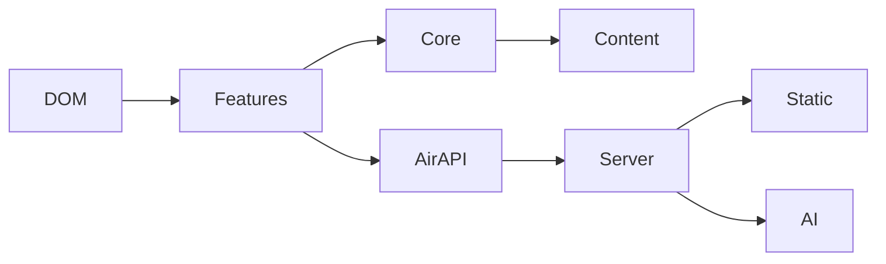

# Architecture

Native ES modules remove classic-script globals. `createApp(deps)` owns per-page state and injects DOM, fetch and modules. Feature modules own interactions; `app.js` is pure planning logic; `content/en.js` owns advice strings. The Node server serves static files and proxies AI and station data. Dependency injection keeps browser and Node tests deterministic.
