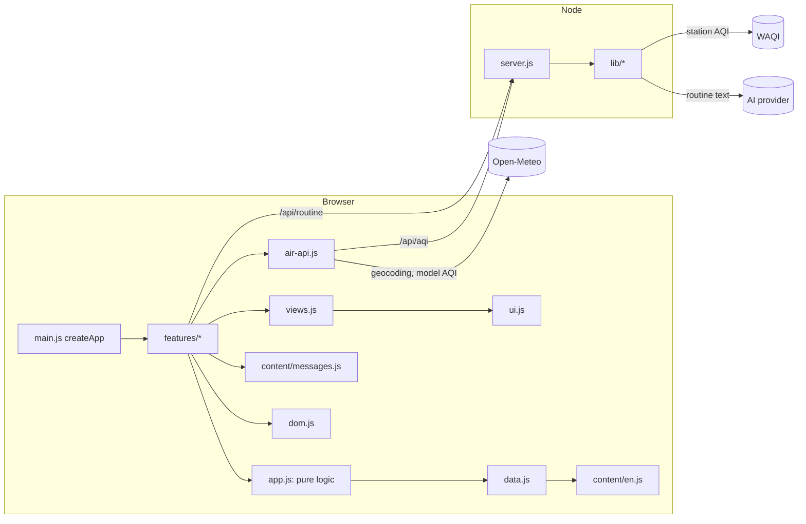

# Architecture

Smog Companion is a small web app with no framework and no build step. The browser runs native ES modules; a
zero-dependency Node server serves the files and proxies two optional services so their keys never reach the page.

## Layers and what each owns

| Layer                     | Responsibility                                                                          | Rule                                  |
| ------------------------- | --------------------------------------------------------------------------------------- | ------------------------------------- |
| `js/app.js`, `js/data.js` | Profile whitelisting, ranking, routine, AI prompt                                       | Pure functions, no DOM, no I/O        |
| `js/content/`             | Every sentence the user reads (advice, statuses, errors)                                | Text only, easy to translate          |
| `js/air-api.js`           | Network access, cache, request merging, timeouts                                        | Throws `ApiError`/`ValidationError`   |
| `js/views.js`, `js/ui.js` | Turn data into DOM nodes                                                                | `textContent` only, never `innerHTML` |
| `js/features/*`           | One module per page feature; reads the DOM through `deps.$` and calls the layers above  | Receives everything via `deps`        |
| `js/main.js`              | `createApp(deps)` assembles the dependencies and starts the features                    | The only place with defaults          |
| `server.js`, `lib/*`      | Static files (Brotli/gzip, ETag), security headers, rate limits, AI and station proxies | Keys stay here                        |

## Data flow for one visit

1. `main.js` builds `deps` (document, window, fetch, modules, shared `state`) and calls each feature's `init`.
2. A search calls `Api.geocode`; picking a result calls `Api.fetchAqi`, which tries `/api/aqi` (nearest station) and
   falls back to Open-Meteo. The client remembers when the server has no station route and stops asking.
3. Submitting the planner reads the form, calls `Core.buildPlan` (whitelists every field first) and renders cards.
4. The optional AI button posts only the whitelisted profile to `/api/routine`; the server builds the prompt.

## Design decisions

- **Dependency injection through `deps`.** Tests run the whole page against a jsdom document and a fake network
  without globals or a bundler, and any module can be replaced.
- **Typed element lookup (`deps.$`).** A missing or wrong element fails immediately with a clear message, and
  TypeScript knows the element type, so there are no `null` checks scattered through the features.
- **Content apart from logic.** Wording changes (or a new language) touch `content/` only.
- **Named constants and errors.** Numbers live in `constants.js`; failures use `ApiError` and `ValidationError` so
  callers can tell a bad request from a failing upstream service.
- **Security by construction.** Strict CSP (the `<meta>` tag and the header are checked to match), whitelisted
  input, no `innerHTML`, bounded rate limiter and body size, only three public locations are served.
- **Quality gates in one command.** `npm run check` runs ESLint (complexity, size and magic-number limits),
  `tsc --strict` over the JSDoc types, Prettier and the tests; CI also enforces coverage thresholds.
